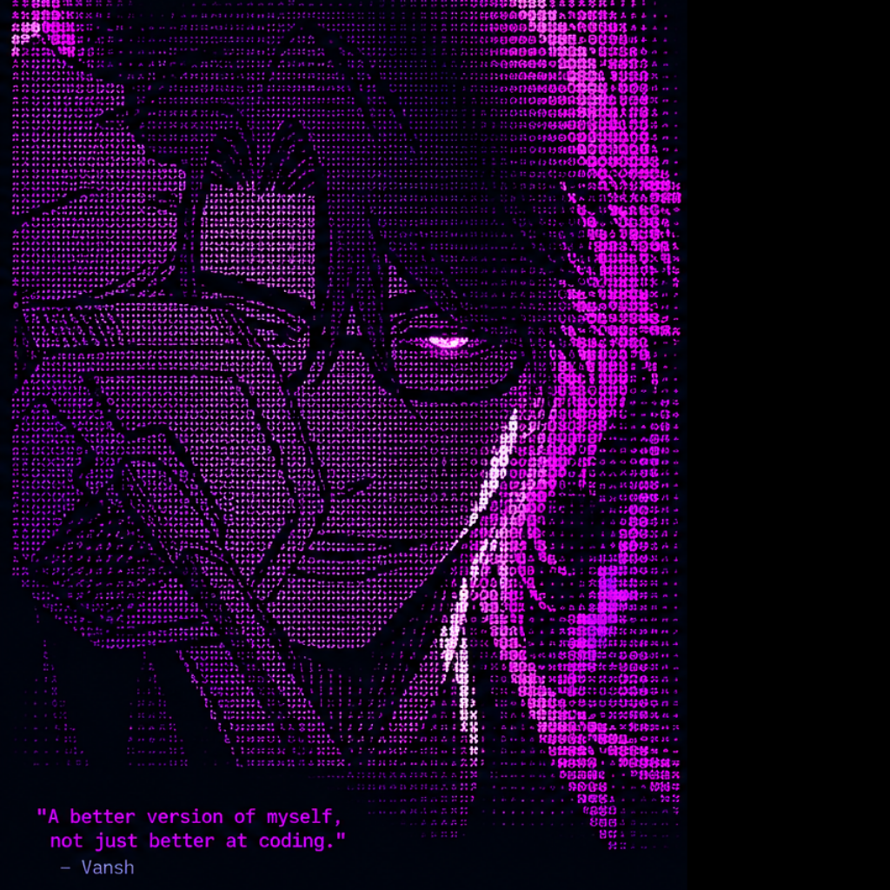

<div align="center">

<table>
<tr>
<td width="43%" align="center" valign="middle">



</td>
<td width="57%" valign="middle">

# `Vansh Kalawatia`

### `DEVELOPER / LEARNER / BUILDER`

**Code · Learn · Build · Repeat**

📍 Jaipur, India

🎓 B.Tech (CSE) | 3rd Year

💻 Aspiring Software Engineer

🐍 Python Backend | DSA | Linux

[](https://github.com/vanshkalawatia)

[](mailto:YOUR_EMAIL@example.com)

### `> system`

```text
OS       : Fedora Linux
Focus    : Python Backend
Language : Python
DSA      : Learning
Editor   : VS Code
Workflow : Git + GitHub
Shell    : Terminal
```

</td>
</tr>
</table>

</div>

---

## `> tech_stack`

<div align="center">

| Programming | Backend | Tools |
|:---:|:---:|:---:|
|  |  |  |
|  |  |  |
|  |  |  |
| | |  |

</div>

---

<table>
<tr>
<td width="56%" valign="top">

## `> current_goals`

- ➜ Master DSA and core Computer Science
- ➜ Become proficient in Python backend development
- ➜ Build real-world projects using FastAPI
- ➜ Get a software engineering internship in Summer 2027
- ➜ Learn system design and networking
- ➜ Contribute to open source
- ➜ Become a strong software engineer
- ➜ Achieve financial independence
- ➜ Work internationally

### `> mindset`

> "A better version of myself, not just a better coder."

</td>

<td width="44%" valign="top">

## `> currently_learning`

- [ ] Python fundamentals
- [ ] Data Structures & Algorithms
- [ ] Problem solving
- [ ] FastAPI and REST APIs
- [ ] SQL and PostgreSQL
- [ ] Git and GitHub workflows
- [ ] Linux and networking
- [ ] Docker and deployment
- [ ] System Design fundamentals
- [ ] Open Source contribution

</td>
</tr>
</table>

---

## `> projects`

I'm focused on building projects that demonstrate fundamentals, clean code, and practical engineering.

| Project | Description | Status |
|:---|:---|:---:|
| Coming soon | Practical backend and software engineering projects | In progress |

---

## `> github_activity`

<div align="center">

<a href="https://github.com/vanshkalawatia">


</a>

</div>

---

<div align="center">

### `{ dream }  >  plan  >  code  >  improve  >  achieve`

**Building skills today. Building useful things tomorrow.**

[](https://github.com/vanshkalawatia)

</div>
