<!-- Every card is an animated SVG drawn by scripts/render_readme_cards.py.
     Design: Monochrome Manga Noir — high contrast, editorial serif & monospace aesthetic.
     Spacing is baked into the SVGs, so keep this block free of blank lines and keep the cards in
     a row on one line with no spaces between them. -->

 
 
 
 
<picture><source media="(prefers-color-scheme: dark)" srcset="./cards/title-coding-dark.svg" /></picture> 

<a href="https://linkedin.com/in/vanshkalawatia">linkedin</a> &nbsp;/&nbsp; <a href="mailto:vanshkalawatia2@gmail.com">email</a> &nbsp;/&nbsp; <a href="https://github.com/vanshkalawatia">github</a> &nbsp;/&nbsp; <a href="https://github.com/despair0x00">despair0x00</a>

