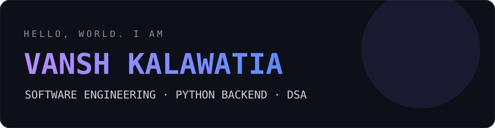
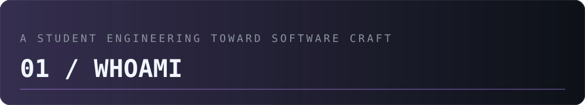
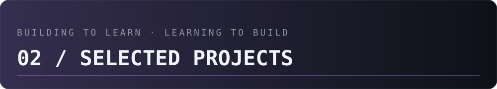
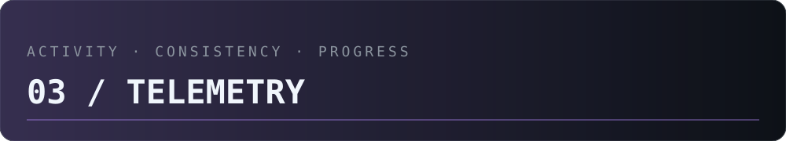
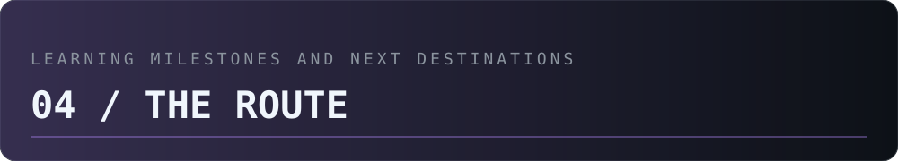
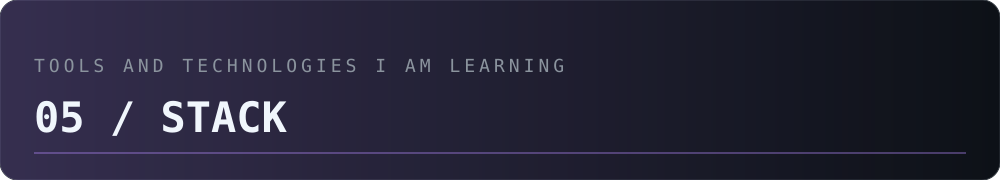

<picture>
  <source media="(prefers-color-scheme: dark)" srcset="assets/dark/header.svg"/>
  
</picture>

<picture>
  <source media="(prefers-color-scheme: dark)" srcset="assets/dark/01-whoami.svg"/>
  
</picture>

<table>
<tr>
<td width="32%" align="center" valign="middle">

</td>
<td width="68%" valign="middle">

### VANSH KALAWATIA

**B.Tech Computer Science student · Aspiring Software Engineer**

I'm focused on building strong engineering fundamentals through independent coding, problem solving and practical backend projects.

- **Based in:** Jaipur, India
- **Primary language:** Python
- **Backend path:** FastAPI · REST APIs · PostgreSQL
- **Core practice:** Data Structures & Algorithms
- **Environment:** Fedora Linux · Git · GitHub
- **Next milestone:** Summer 2027 software engineering internship

</td>
</tr>
</table>

<picture>
  <source media="(prefers-color-scheme: dark)" srcset="assets/dark/02-projects.svg"/>
  
</picture>

I want my repositories to show how I think, learn and engineer—not just that I followed a tutorial. I'll feature projects here as they become ready.

| Project | What it demonstrates | Status |
|:--|:--|:--:|
| Projects in progress | Python, backend development and problem solving | Building |

<picture>
  <source media="(prefers-color-scheme: dark)" srcset="assets/dark/03-telemetry.svg"/>
  
</picture>

<picture>
  <source media="(prefers-color-scheme: dark)" srcset="assets/dark/04-route.svg"/>
  
</picture>

| Phase | Focus | Direction |
|:--|:--|:--|
| Current | Python, DSA and CS fundamentals | Build strong foundations |
| Next | FastAPI, SQL, PostgreSQL and testing | Ship backend projects |
| 2027 target | Internship preparation and open source | Gain engineering experience |
| Long term | Software engineering career | Grow into an independent engineer |

<picture>
  <source media="(prefers-color-scheme: dark)" srcset="assets/dark/05-stack.svg"/>
  
</picture>

**LANGUAGES**

**BACKEND & DATA**

**TOOLS & ENVIRONMENT**

---

**CURRENTLY WORKING ON**

`Python` · `DSA` · `FastAPI` · `PostgreSQL` · `Open Source`

*Learn deliberately. Build consistently. Improve continuously.*

[GitHub repositories](https://github.com/vanshkalawatia?tab=repositories) · [Contact](mailto:vanshkalawatia2@gmail.com)

